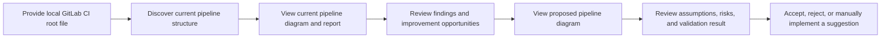

# Product Requirements Document: GitLab CI Pipeline Insight Assistant

## 1. Product summary

GitLab CI Pipeline Insight Assistant helps engineering teams understand, review, and improve complex GitLab CI/CD pipelines before changing or running them.

A user supplies the root `.gitlab-ci.yml` file from a local repository. The product creates a clear visual representation of the current pipeline, identifies important dependencies and bottlenecks, and produces evidence-backed suggestions for a simpler or faster pipeline structure. For every proposed structural improvement, the product shows a before-and-after diagram, the expected benefit, and the assumptions or risks that require human review.

The product is an analysis and recommendation assistant. It does not run pipelines, change a user's files, or apply suggested changes automatically.

## 2. Problem statement

GitLab CI/CD configurations become difficult to understand as projects gain more stages, parallel jobs, job dependencies, reusable local configuration files, conditional jobs, artifacts, and deployments. Engineers often need to read multiple YAML files and mentally reconstruct the execution order.

This causes practical problems:

- New team members struggle to understand how code reaches test and deployment environments.
- A job may wait for unrelated work because of stage ordering.
- A change to one job can block, skip, or delay many downstream jobs.
- Configuration mistakes are discovered only after a pipeline is created or fails.
- Pipeline improvements are difficult to review because the expected structural effect is not visible.
- Teams lack a simple artifact that documents the actual pipeline architecture.

The product makes the pipeline structure visible and makes improvement proposals reviewable before they are adopted.

## 3. Product vision

Enable an engineer to answer the following questions in a few minutes, without manually tracing YAML files:

- What jobs exist and what is their execution order?
- Which jobs can run in parallel?
- Which jobs block a deployment or the earliest useful test feedback?
- What happens downstream if a particular job fails?
- Are any job references, stages, or local configuration links invalid?
- Which potential pipeline improvements are worth reviewing?
- If a suggested change is accepted, how will the pipeline graph change?

## 4. Target users

### Primary users

- DevOps engineers maintaining GitLab CI/CD configuration.
- Platform engineers supporting many repositories or teams.
- Software engineers who own their service's pipeline.

### Secondary users

- Engineering managers reviewing delivery bottlenecks.
- New team members learning a repository's release workflow.
- Security and release teams reviewing deployment controls.

## 5. User stories

### Understand an existing pipeline

As an engineer, I want to supply a GitLab CI configuration and receive a diagram of its stages, jobs, and dependencies so that I can understand the workflow without manually tracing YAML.

### Identify parallel work

As an engineer, I want to see which jobs can begin together and which jobs are waiting on dependencies so that I can identify avoidable delays.

### Assess a failure's impact

As an engineer, I want to select or inspect a job and see the downstream jobs affected by its failure so that I can understand delivery risk.

### Find configuration problems early

As an engineer, I want clear findings for missing jobs, invalid stage references, include problems, and circular dependencies so that I can correct issues before pipeline execution.

### Review a proposed improvement

As an engineer, I want every optimization recommendation to include its reason, expected structural outcome, assumptions, risks, and before-and-after diagrams so that I can make an informed decision.

### Produce reusable documentation

As a team member, I want shareable pipeline diagrams and reports so that the pipeline can be understood during onboarding, reviews, and release planning.

## 6. Primary user journey



## 7. Functional requirements

### 7.1 Configuration intake

- Accept a local repository path or a local root GitLab CI configuration file.
- Treat `.gitlab-ci.yml` as the default root configuration file.
- Identify and include locally referenced CI configuration files.
- Clearly report a missing root file, unreadable file, malformed YAML, or unavailable local include.
- Never modify the supplied repository.

### 7.2 Current pipeline understanding

The product must identify and present:

- pipeline stages and their stated order;
- visible executable jobs;
- hidden/template jobs, separately from executable jobs;
- job names and display names where available;
- each job's stage;
- explicit job-to-job execution dependencies;
- artifact download relationships;
- conditional-job indicators;
- parallel or matrix-job indicators;
- local include relationships.

The product must distinguish between:

- an explicit dependency declared by the configuration; and
- a wait caused by ordinary stage ordering.

### 7.3 Current pipeline visualization

- Generate a Mermaid diagram for the current pipeline.
- Show jobs as nodes and execution relationships as directed edges.
- Group jobs by stage where this improves readability.
- Visually distinguish explicit execution dependencies from artifact relationships.
- Mark conditional jobs and template jobs clearly.
- Produce a diagram that remains understandable for a medium-sized pipeline.

### 7.4 Current pipeline insights

Generate a report containing:

- number of stages and executable jobs;
- root jobs that can begin immediately;
- terminal jobs with no downstream work;
- groups of jobs that can run in parallel;
- the structural critical path, expressed as the longest chain of dependent jobs;
- upstream and downstream impact for every job;
- stage-based waiting relationships;
- a concise plain-language summary of the pipeline's execution model.

The product must state that a structural critical path is not a real duration estimate unless actual historical job-duration data is available.

### 7.5 Validation findings

The product must detect and report, with source-file context:

- malformed YAML;
- missing local include files;
- cycles in local includes;
- jobs assigned to an undefined stage;
- explicit dependencies that reference a missing job;
- circular job dependencies;
- duplicate executable job names after local configuration is combined;
- jobs that appear isolated from the main pipeline;
- potentially conditional dependencies that may not exist in every pipeline run.

Each finding must include severity, explanation, evidence, and a recommended next action.

### 7.6 Optimization opportunities

The product must identify evidence-backed opportunities such as:

- a job delayed by an entire prior stage when its likely prerequisites are narrower;
- an early-feedback job that may be eligible to start immediately;
- a long structural dependency chain;
- duplicate or unnecessarily repeated pipeline patterns visible in local configuration;
- an unnecessarily broad artifact relationship;
- a possible missing execution dependency where an artifact is consumed;
- configuration complexity caused by excessive stage barriers.

An opportunity is not a guaranteed safe change. Every recommendation must be labeled as one of:

- **High confidence**: a deterministic configuration problem or an unambiguous improvement.
- **Review recommended**: a graph-based opportunity that needs human confirmation of job behavior.
- **Manual design decision**: an architectural suggestion that cannot be proven from configuration alone.

### 7.7 Proposed structure comparison

For each recommendation that produces a possible pipeline change, provide:

- a short title and plain-language explanation;
- the evidence from the current configuration;
- a proposed configuration snippet or patch preview;
- a proposed Mermaid diagram;
- a before-and-after graph comparison;
- expected changes to dependency chains and potential parallelism;
- assumptions that could affect correctness;
- risks, including artifact, environment, or implicit-script dependencies;
- a validation result for the proposed structure.

The product must never present a suggestion as automatically safe when the configuration alone cannot establish job semantics.

### 7.8 Reports and saved artifacts

For each analysis, produce:

- current pipeline Mermaid diagram;
- proposed pipeline Mermaid diagrams, where applicable;
- human-readable Markdown report;
- structured JSON report for future integrations;
- a concise summary suitable for a merge-request comment or team discussion.

Reports must preserve the file and job evidence behind each important finding.

## 8. Optional AI-assisted review

AI-assisted review is outside the required deterministic core and must be disabled by default.

When enabled, it may:

- explain findings in clearer language;
- rank already-detected opportunities;
- propose a limited number of alternative pipeline structures;
- explain trade-offs between faster feedback, runner cost, and configuration complexity.

It must not:

- silently change files;
- invent jobs, dependencies, or runtime behavior without labeling assumptions;
- replace deterministic validation;
- provide recommendations without showing supporting configuration evidence.

Every AI-proposed change must pass the same configuration and graph validation used for deterministic suggestions before being shown as a viable proposal.

## 9. Non-goals for V1

- Running, retrying, cancelling, or deploying GitLab pipelines.
- Editing a user's CI configuration automatically.
- Supporting GitHub Actions, Jenkins, Azure DevOps, or other CI providers.
- Resolving remote, project, component, or template includes.
- Accessing private GitLab instances, job logs, secrets, or runner infrastructure.
- Estimating actual pipeline duration or cost from configuration alone.
- Expanding every matrix-job permutation.
- Proving that a proposed restructuring preserves all shell-script, artifact, database, or environment behavior.
- Replacing GitLab's own CI linting, pipeline execution validation, or security controls.

## 10. Product principles

- **Evidence before recommendation:** every insight must cite the relevant job, stage, or source configuration.
- **Explain uncertainty:** distinguish facts, inferences, and assumptions.
- **Human control:** recommendations are reviewed and applied by a person.
- **Read-only by default:** the product analyzes configuration without changing it.
- **Useful without AI:** core value must work without an LLM call.
- **Portable outputs:** reports and Mermaid diagrams should be easy to share and version-control.
- **Focused scope:** support GitLab CI local configuration well before adding more CI platforms.

## 11. Success measures

### Product success

- A user can understand a medium-sized local GitLab pipeline from the generated report and diagram without manually tracing every YAML file.
- The diagram correctly represents jobs, stages, and explicit dependencies for representative sample pipelines.
- Invalid references and cycles are surfaced before a user attempts to run the pipeline.
- Every suggested restructuring includes a before-and-after comparison and explicit assumptions.
- Users can export artifacts that are useful in pull-request discussion and onboarding.

### Quality measures

- No modification is made to the analyzed repository.
- Findings contain enough evidence for a user to verify them in the source configuration.
- Unsupported configuration features are disclosed instead of silently ignored.
- Invalid or ambiguous proposals are rejected or labeled for manual review.

## 12. Release plan

### V1 — Static pipeline understanding

- Local root `.gitlab-ci.yml` input.
- Local include discovery.
- Stage, job, `needs`, and artifact-relationship understanding.
- Current Mermaid diagram.
- Validation findings.
- Parallel-group and structural-critical-path insights.
- Markdown and JSON reports.

### V1.1 — Reviewable recommendations

- Deterministic optimization opportunity detection.
- Before-and-after graph comparisons.
- Proposed configuration snippets.
- Assumption and risk reporting.

### V2 — Connected and historical analysis

- Optional GitLab configuration validation.
- Historical pipeline and job-duration data.
- Time-based critical path and runner-cost insights.
- Pipeline-change comparison between revisions.

### V3 — Optional AI-assisted design review

- Human-requested explanations and restructuring proposals.
- Constraint-based proposal generation.
- Deterministic validation of every proposal.
- Approval-based patch export only.

## 13. Example outcome

```text
Finding: API tests wait for the complete build stage.

Evidence:
- `test_api` is in the `test` stage.
- `test_api` has no explicit execution dependencies.
- `build_api` and `build_web` are both in the earlier `build` stage.

Opportunity:
Review whether `test_api` requires only `build_api`.

Potential result:
- `test_api` may begin when `build_api` completes.
- It no longer waits for unrelated `build_web` work.

Risk:
Confirm that `test_api` does not consume an artifact, service, or environment created by `build_web`.

Decision required:
Human approval before applying the proposed configuration change.
```

## 14. Open product decisions

- Should the first interface be a command-line tool, a small web interface, or a GitLab merge-request integration?
- What pipeline size should be considered a supported medium-sized pipeline for V1?
- Which finding severities should block a release report versus remain informational?
- Should proposed configuration snippets be included in V1 or begin in V1.1?
- Should Mermaid be the only visual output in V1, or should rendered SVG/PNG be included?
- Which optimization opportunities are sufficiently safe to label high confidence?
