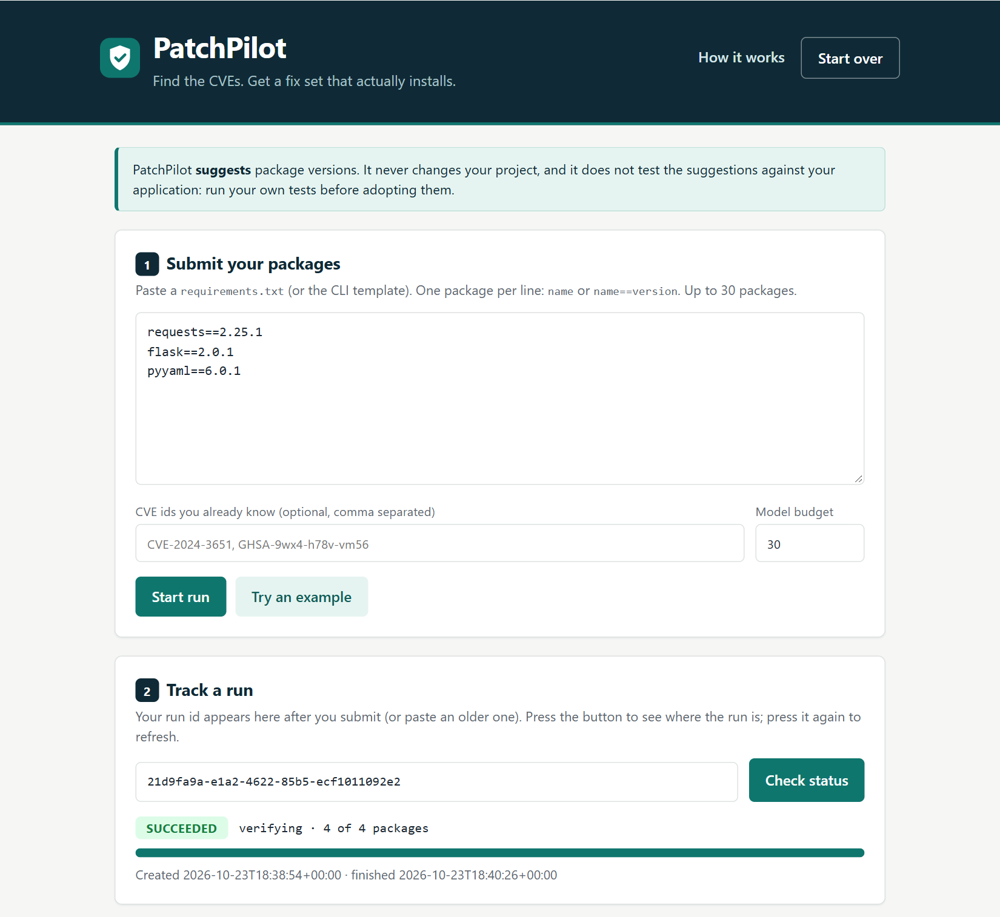
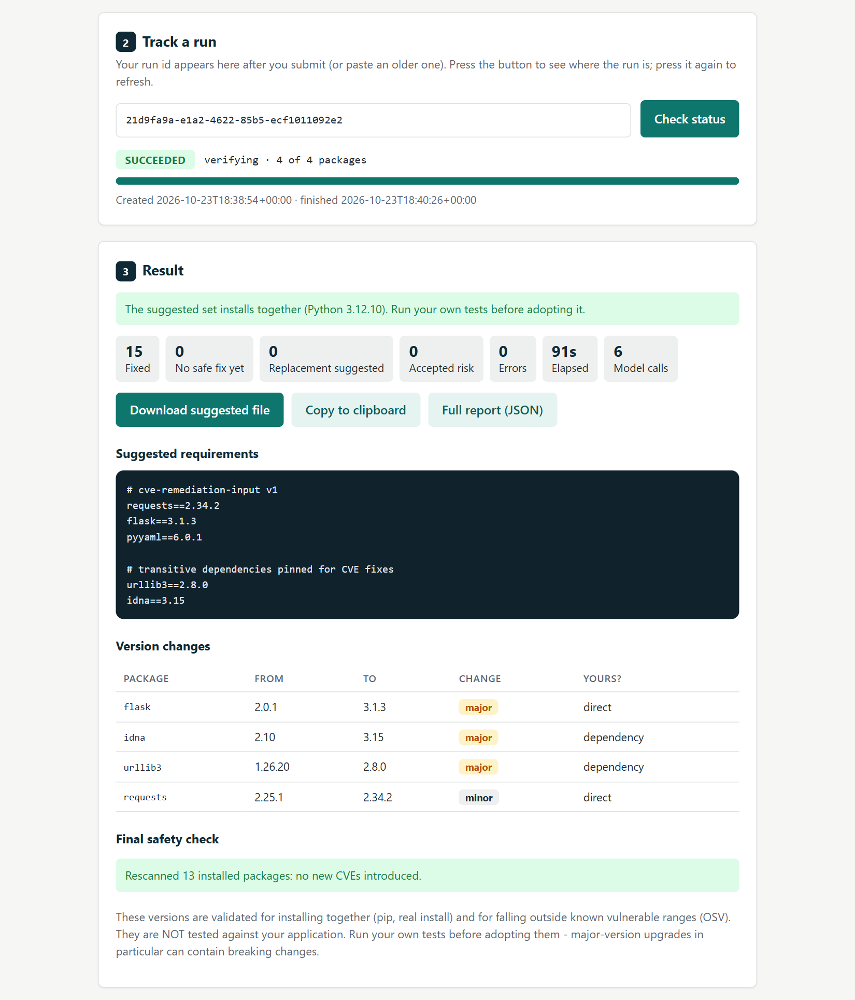
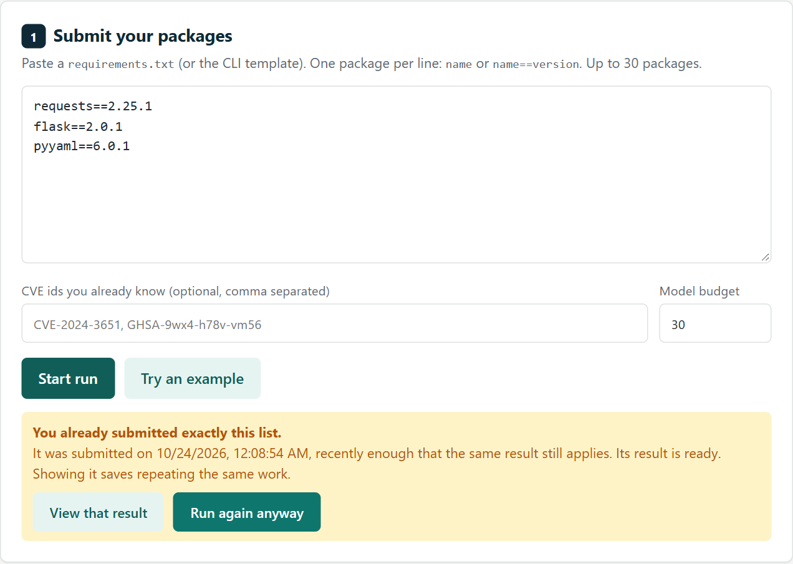
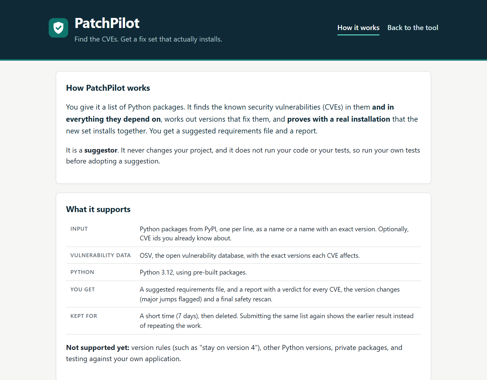
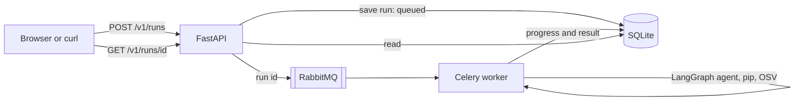

# PatchPilot

**Find the CVEs. Get a fix set that actually installs.**

Paste a list of Python packages. PatchPilot finds the known security vulnerabilities (CVEs) in them **and
in everything they depend on**, works out versions that fix them, and **proves with a real installation
that the new set installs together**. You get a suggested requirements file and a report.



*Paste your packages, start a run, and track it with the run id.*



*A real run: three packages in, the whole dependency tree analysed, 15 CVEs fixed in 91 seconds, every major upgrade flagged, and a final rescan that found nothing new.*

**Stack:** Python · LangGraph (AI agent) · FastAPI · RabbitMQ + Celery · SQLite · Docker Compose on AWS EC2 · pytest (about 600 tests)

## What makes it interesting

- **Code decides, the AI only helps.** For each package the smallest safe version is tried first and
  checked against your whole project with pip. A language model is called only when a fix conflicts with
  something else (for example a parent package caps the vulnerable dependency). On the benchmark, 17 of the 18
  affected packages never needed it, and runs dropped from 46 to 8-15 minutes.
- **Proof, not opinion.** The final set is installed for real in a throwaway environment, and every CVE is
  judged against the versions pip actually installed, then rescanned to catch anything the changes introduced.
  The model can suggest, but it can never make something install that doesn't.
- **A proper job-queue backend.** FastAPI accepts a run and returns an id at once. A Celery worker fed by
  RabbitMQ does the long work and writes progress to the database; the client polls. Workers acknowledge a job
  only when it finishes, and repeating a job is harmless (idempotent).
- **Layered, tested, defensive.** Handler, service and repository layers; one place that turns business errors
  into HTTP responses; request ids; body-size limits; strict input schemas; browser security headers; API docs
  off by default; and identical requests within 24 hours reuse the earlier result instead of repeating the work.

## More screenshots

**Submitting the same list again offers the earlier result instead of repeating the work:**



**The How it works page:**



## Architecture



The database is the source of truth; RabbitMQ only carries "run this id". The API never does the heavy
work, so a long run never blocks a request. Details: [`docs/architecture.md`](docs/architecture.md).

## Run it

**As a service (Docker Compose: api, worker, rabbitmq):**

```bash
cp .env.example .env            # set GEMINI_API_KEY and RABBITMQ_PASSWORD (letters and digits only)
docker compose up -d --build
```

Open `http://localhost:8000/` for the web page, or use the API:

```bash
curl -X POST localhost:8000/v1/runs -H "Content-Type: application/json" \
     -d '{"packages":[{"name":"requests","version":"2.25.1"}]}'
curl localhost:8000/v1/runs/<run_id>                 # status and progress
curl localhost:8000/v1/runs/<run_id>/suggested-file  # the fixed requirements
```

**As a command-line tool:**

```bash
python -m venv .venv && source .venv/bin/activate     # Windows: .\.venv\Scripts\Activate.ps1
pip install -e ".[dev]"
cp .env.example .env                                  # then add your API key
cp templates/requirements.template.txt my-project.txt # edit: replace the example packages
python main.py my-project.txt
```

**Tests:** `pip install -e ".[api,dev]" && pytest`

## Documentation

| Document | For |
|---|---|
| [`docs/api-guide.md`](docs/api-guide.md) | The HTTP service: endpoints, run lifecycle, errors, limits, Docker Compose, security headers |
| [`docs/user-guide.md`](docs/user-guide.md) | The command-line tool: the template, running it, reading the results |
| [`docs/architecture.md`](docs/architecture.md) | How it works: the flow, **when the model is called**, algorithms, the security model, a file-by-file code map |
| [`docs/requirements.md`](docs/requirements.md) | The input/output contract and the rules the product follows |

## Project layout

```text
main.py       command-line entry point
api/          the HTTP service: handlers, services, repository, queue, worker (layered)
web/          the static web page and the How it works page
service/      the LangGraph wiring: graph, state, guardrails, resolution logic, prompts, model factory
tools/        one real action per file: parse, discover, verify, versions, check compatibility
utils/        HTTP, PyPI/OSV clients, interpreter and file helpers
domain/       shared data models and validation patterns
tests/        pytest suite
docs/         guides and screenshots
Dockerfile, docker-compose.yml   one image, three containers
```

## Status and limits

A working **proof of concept**, deployed and tested end to end. It suggests versions only: it does not test
them against your application, so run your own tests before adopting them.

**Known limits (the v2 list):**
- No login yet; the demo deployment is protected by a network firewall only, and served over plain HTTP.
- Python 3.12 and pre-built packages only; no version rules on input (for example "stay on Django 4.x").
- SQLite on one machine; a run that crashes starts over (no resume).
- No per-user ownership, rate limiting or run time limits.

**Planned:** accounts and per-user runs, HTTPS, abuse limits, a React front end, multiple Python versions.
